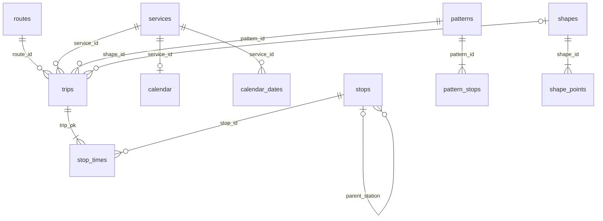

# Fase 1A — Catálogo GTFS estático local

## Resultado

Catálogo real importado y consultable desde SQLite. Se implementaron importación
atómica por lotes, búsqueda de estaciones/plataformas, opciones de ruta/patrón
según calendario y ventana horaria, destinos posteriores y una CLI reproducible.
**La Fase 1B no se inició y requiere autorización.** No hay tracking, sondeos,
GUI, Telegram, predictor ni uso de Croma.

Se conserva la estructura `src/transmitracker/`. Los lectores, fixtures y
resultados de investigación de Fases 0 y 0.5 no se sustituyeron. No se instalaron
dependencias nuevas; SQLite y FTS5 vienen con el Python instalado.

## Importación real medida

Fuente: `data/probes/official_static.zip`, ya descargado en Fase 0 desde
`https://gtfs.transmilenio.gov.co/GTFS.zip`. Esta fase no lo volvió a descargar.
El SHA coincide con la evidencia original de Fase 0.

| Métrica | Resultado |
| --- | --- |
| SHA-256 del ZIP | `c66c7af657371eac892bab4b327e3a1e7be5d19ae0e9e5b4355e231261e3a09d` |
| Tamaño del ZIP | 180.271.992 bytes |
| Base creada | `data/catalog/official_20261112.sqlite3` |
| Importación finalizada | 12-11-2026 22:51:27, America/Bogota |
| Tiempo total de la llamada | **169,32 s** — aproximadamente 2 min 49 s |
| Tiempo procesando `stop_times` | 110,91 s |
| Tiempo procesando geometrías | 5,12 s |
| Construcción de patrones | 19,89 s |
| Índices, FTS y estadísticas | 19,96 s |
| Tamaño final de SQLite | **673.136.640 bytes = 673,14 MB = 641,95 MiB** |
| Tamaño de lote | 10.000 filas |
| Python / SQLite | Python 3.13.14 / SQLite 3.50.4, Windows x64 |

Los tiempos son una medición de esta máquina y este ZIP, no una garantía de
rendimiento en otros equipos. El total incluye validaciones y publicación; los
subtiempos no incluyen por separado todo el costo de integridad/hash.

| Tabla o entidad | Registros |
| --- | ---: |
| Rutas importadas | **1.054** |
| Estaciones y paraderos buscables | **8.325** |
| Paradas/plataformas `location_type=0` | 8.167 |
| Estaciones padre `location_type=1` | 158 |
| Viajes | 181.070 |
| Horarios de parada | **9.464.235** |
| Puntos de geometría | 952.585 |
| Geometrías distintas | 1.054 |
| Patrones derivados | **1.564** |
| Calendarios / excepciones | 7 / 133 |
| Ventanas de frecuencia | 14 |
| Agencias | 7 |

Hay **1.052 rutas con viajes y horarios** y **8.155 paradas distintas presentes
en `stop_times`**. No se inventan horarios para las otras dos rutas. Todos los
8.325 nodos son buscables; ser una estación padre o figurar en el catálogo no
garantiza un embarque válido en cualquier fecha/hora.

## Esquema y versión

La primera migración está declarada en `catalog/schema.py`, con
`PRAGMA user_version=1`. Cada base contiene **una versión inmutable del ZIP**;
otra versión necesita otro archivo de base. `catalog_versions` registra SHA-256,
origen local, URL de procedencia, tamaño, fecha con zona, versión de esquema,
lote, conteos y tiempos. Esto evita mezclar IDs entre catálogos distintos.



También se conservan agencias, `feed_info` y frecuencias. `services` se forma de
la unión explícita de IDs publicados en `calendar` y `calendar_dates`, admitiendo
fuentes con solo excepciones. Los IDs originales son **TEXT**, incluidos sus
ceros iniciales. `trip_pk` es una clave interna para reducir repetición en los
9,4 millones de horarios; nunca sustituye ni transforma el `trip_id` publicado.
Las horas se almacenan como segundos de día de servicio, sin módulo 24.

Los patrones son derivados locales, identificados por SHA-256 de ruta, dirección
publicada, geometría y secuencia ordenada de paradas con reglas de subida/bajada.
Se conserva `stop_sequence` original. Variaciones de geometría, secuencia,
permisos o sentido generan patrones distintos, aunque compartan nombre de ruta.
La numeración diferente de secuencia puede separar patrones equivalentes: es
una distinción conservadora, no una fusión asumida. No son IDs oficiales nuevos.

## Eficiencia, integridad e idempotencia

El ZIP se lee como CSV UTF-8 con soporte BOM, sin extraer rutas al disco. Los
archivos grandes se insertan con `executemany` por lotes. Solo se mantienen en
memoria el lote, mapas de los 181.070 viajes, caché acotada de horas y la secuencia
de un viaje al construir patrones; no todos los `stop_times` ni geometrías.
El caché de páginas SQLite está limitado a 64 MiB; no es un límite del proceso.

La importación escribe una base temporal única en el mismo directorio. Comprueba
archivos/columnas, claves, referencias y frecuencia, verifica de nuevo el hash
del ZIP y publica el archivo final solo al completar. Ante error elimina su
archivo temporal, sin publicar un catálogo parcial ni modificar uno existente.
El ZIP tiene límite de 3 GiB descomprimidos. No se declara validación integral
de todas las extensiones o reglas semánticas GTFS.

Si la base ya contiene el mismo hash y esquema, se reutiliza sin reimportar.
Si contiene otro hash/esquema, se rechaza y se exige un destino diferente.
La prueba real verificó **hash y fecha de modificación de SQLite idénticos antes
y después**; la comprobación de reimportación tomó unos **0,13 s**.
`PRAGMA quick_check` devolvió `ok` y `foreign_key_check` no encontró huérfanos.

## Índices

Además de claves primarias y la unicidad de `trip_id`:

| Índice | Finalidad |
| --- | --- |
| `idx_stops_parent` | Expandir estación a sus plataformas descendientes |
| `idx_stops_code` | Acceso por código publicado |
| `idx_stop_times_stop_departure` | Embarques por parada/hora; incluye viaje y secuencia |
| `idx_trips_route_pattern_service` | Selección por ruta, patrón y servicio |
| `idx_trips_service` | Filtro de calendario |
| `idx_trips_pattern` | Viajes de un patrón |
| `idx_pattern_stops_stop` | Presencia y ocurrencia de paradas en patrones |
| `idx_patterns_route_direction` | Patrones por ruta/sentido publicado |
| FTS5 `stop_search` | Búsqueda por palabras/prefijos de nombre o código, sin distinguir acentos |

Los horarios usan clave compuesta `(trip_pk, sequence)` y las geometrías
`(shape_id, sequence)`, ambas `WITHOUT ROWID`. Se ejecutó `ANALYZE`.
El plan real de búsqueda por parada y rango de salida confirmó
`USING COVERING INDEX idx_stop_times_stop_departure`.

## Consultas y límites explícitos

- `search_stops`: palabras/prefijos de nombre o código, con acentos normalizados
  solo para buscar; devuelve ID, padre, plataforma y número de hijos sin alterar
  los valores publicados. No es búsqueda difusa por errores ortográficos.
- `stop_family`: una estación expande a sus descendientes; seleccionar una
  plataforma no agrega sus hermanas. No se conectan paradas cercanas por distancia.
- `routes_for_stop` y `options`: rutas y patrones con embarque dentro de una
  ventana explícita, predeterminada de 120 minutos y configurable entre 1 y 1.440.
  Exigen servicio activo y al menos un destino posterior con bajada permitida.
- `destinations`: valida ruta, dirección y patrón, filtra viajes activos y devuelve
  exclusivamente secuencias posteriores. `validate_destination` rechaza destinos
  anteriores, ajenos al patrón o sin bajada permitida.
- Si una parada se repite en un recorrido, hay que elegir `origin_sequence`;
  no se elige silenciosamente la primera ocurrencia de un bucle.

El calendario semanal se ajusta con altas/bajas de `calendar_dates`. Para una
hora civil posterior a medianoche se consideran también días de servicio previos,
según el máximo horario/frecuencia de este catálogo. Se probaron `25:00:00` y
`49:00:00`, incluyendo ventanas de frecuencia que cruzan medianoche. La API
exige datetimes con zona; usa America/Bogota y rechaza otras zonas de agencia
durante la importación para no calcular incorrectamente su calendario.

`frequencies` con `exact_times=1` permite calcular la siguiente salida programada
de la rejilla. Con `exact_times=0` solo se comunica disponibilidad por ventana y
headway: `next_boarding_at` y `arrival_at` quedan en `None`. No se inventa una
salida exacta. Las horas originales de plantilla se identifican por separado.
Esto sigue la [referencia GTFS Schedule](https://gtfs.org/documentation/schedule/reference/).

Por defecto solo se ofrecen subidas/bajadas regulares (`pickup_type=0`,
`drop_off_type=0`). El API permite optar por servicios condicionales 2/3,
conservando sus indicadores; los prohibidos 1 nunca se ofrecen. No se interpolan
horas ausentes para inventar un embarque. Las horas mostradas son programación,
incluidos posibles tiempos intermedios estimados por el productor: **no son
llegadas reales ni predicciones del proyecto**.

**Limitación del ZIP real:** sus **181.070 viajes omiten `direction_id`**. Se
conserva `NULL`/`unknown`; no se deduce 0/1 del nombre, ID o geometría. El usuario
puede elegir ruta y patrón publicados, pero esta versión no permite etiquetar
oficialmente esos patrones como dirección 0/1. Las pruebas sintéticas sí ejercitan
direcciones 0, 1 y desconocida, y rechazan combinaciones incompatibles.

La fase no unifica estaciones por proximidad, resuelve correspondencias Realtime,
implementa transbordos, mantiene caché de actualización automática ni sustituye
las limitaciones de IDs de las investigaciones previas. Esos datos no se usan
para validar asociaciones operativas.

## Demostración real

Consulta estática para **12-11-2026 08:00 America/Bogota**, ejecutada offline sobre
la base; no representa una observación real de buses a esa hora.

1. Buscar `Portal Norte`: estación `2000`, **Portal Norte - Unicervantes**,
   con nueve plataformas/nodos hijos.
2. Se obtienen **25 opciones** de embarque en la ventana de dos horas.
3. Selección de ejemplo: ruta **`13766` / 2-1**, patrón
   `37a81a22cf512050fb347523e3fb7aea140ff4a36a2be9b98199006e2dacbe66`,
   plataforma **`74389`**, secuencia de origen **2**, dirección **no informada**.
4. Próximo embarque programado: **08:04:56**, con 17 plantillas elegibles
   de ese patrón/fecha dentro de la ventana.
5. Siete destinos posteriores, sin añadir plataformas de otros patrones:

| Secuencia | stop_id | Nombre | Llegada programada del ejemplo |
| --- | --- | --- | --- |
| 3 | `56059` | Br. Tejares del Norte II | 08:12:21 |
| 4 | `56060` | San Pedro Plaza | 08:13:29 |
| 5 | `56128` | Urb. San Pedro | 08:14:47 |
| 6 | `56061` | Br. Santa Amalia | 08:17:23 |
| 7 | `55886` | Patio del Norte | 08:18:42 |
| 8 | `57285` | C.C. Santafé | 08:19:56 |
| 9 | `74387` | Portal Norte Alimentación | 08:22:45 |

Una selección de sentido 0/1 para ese patrón desconocido se rechaza. También
se comprobó rechazo de un ID ajeno al patrón. El rechazo de una parada anterior
se cubre con un fixture determinista. La CLI `demo --auto` completó el mismo flujo.

Medición ilustrativa de consulta real: búsqueda y selección ~0,211 s, opciones
~0,156 s y destinos ~0,053 s. No es un benchmark de todas las rutas ni una
garantía de latencia con caché fría. La evidencia completa está en
`PHASE1A_DEMO.json`; la salida de CLI está en `data/catalog/cli-demo.log`.

## Pruebas y reproducción

**99 pruebas aprobadas = 69 conservadas + 30 nuevas**, en la última ejecución
14,62 s. Ruff sin errores, 40 archivos formateados y `pip check` sin conflictos.
La suite bloquea red. El catálogo sintético se genera por CSV/ZIP dentro de los
temporales del proyecto; no modifica los fixtures ni resultados de Fase 0/0.5.

Los casos nuevos cubren IDs con ceros, acentos/códigos, estación y plataformas,
sentidos, variantes, destinos anteriores/ajenos, excepciones, vigencia, medianoche,
49 horas, frecuencias exactas/aproximadas, subida/bajada, bucles, datos sin zona,
idempotencia, destino existente incompatible, huérfanos y publicación atómica.

Desde la raíz del proyecto:

```powershell
$env:PYTHONPATH = Join-Path (Get-Location).Path 'src'
$env:PYTHONUTF8 = '1'
$env:TEMP = Join-Path (Get-Location).Path '.cache\tmp'
$env:TMP = $env:TEMP
New-Item -ItemType Directory -Force -Path $env:TEMP | Out-Null

# Si ya existe este mismo catálogo, se reutiliza sin modificarlo.
.\.venv\Scripts\python.exe -m transmitracker.catalog import data/probes/official_static.zip --source-url https://gtfs.transmilenio.gov.co/GTFS.zip

# Elegir origen y opción interactivamente; --auto elige la primera disponible.
.\.venv\Scripts\python.exe -m transmitracker.catalog demo 'Portal Norte' --when '2026-11-12T08:00:00-05:00' --auto

# Consultas separadas para una futura GUI.
.\.venv\Scripts\python.exe -m transmitracker.catalog search 'Portal Norte'
.\.venv\Scripts\python.exe -m transmitracker.catalog options 2000 --when '2026-11-12T08:00:00-05:00'
.\.venv\Scripts\python.exe -m transmitracker.catalog destinations 74389 13766 37a81a22cf512050fb347523e3fb7aea140ff4a36a2be9b98199006e2dacbe66 --direction unknown --origin-sequence 2 --when '2026-11-12T08:00:00-05:00'

.\.venv\Scripts\python.exe scripts/verify_phase0.py --output docs/PHASE1A_VALIDATION_RESULTS.json
.\.venv\Scripts\python.exe scripts/demo_phase1a.py
```

Para otra versión: `python -m transmitracker.catalog --db data/catalog/otra_version.sqlite3
import ruta/al/otro.zip`. La CLI limita sus rutas al proyecto. No hay acceso de
red en esos comandos.

## Archivos y siguiente fase

- `src/transmitracker/catalog/`: esquema, importador, consultas, utilidades y CLI.
- `tests/test_catalog.py`: escenarios offline de Fase 1A.
- `scripts/import_phase1a.py` y `scripts/demo_phase1a.py`: mediciones reales reproducibles.
- `docs/PHASE1A_IMPORT.json`, `PHASE1A_DEMO.json`, `PHASE1A_VALIDATION_RESULTS.json`
  y este informe; los informes anteriores permanecen separados.
- README actualizado y adenda al plan con división **Fase 1A/1B**, sin eliminar
  requisitos originales.

Fase 1B queda propuesta para normalización y servicios de selección de perfiles,
política de versiones/actualización de catálogos y contratos para la futura GUI,
con alcance a aprobar. La arquitectura futura de colector compartido permanece
como dirección aceptada; **no se autorizó ni implementó tracking operativo**.
